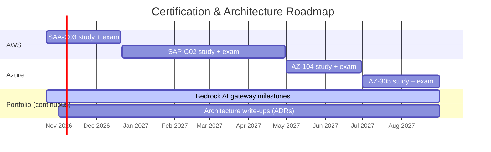

# 🧭 Certification & Architecture Roadmap (Oct 2026 – Aug 2027)

> [!abstract] Goal
> Build depth first, then breadth: **AWS-deep, Azure-credible**. Earn the AWS Solutions Architect certifications on top of daily AWS practice, then add the Azure Solutions Architect Expert credential. Along the way, publish architecture write-ups that show design judgment rather than recall alone.

Back to [[00 - Home|Multi-Cloud Vault Home]] · [[AWS Architecture Hub]] · [[Azure Architecture Hub]]

---

## 🎯 Why This Order

| Decision | Rationale |
| :--- | :--- |
| **AWS first** | Daily work is AWS: multi-account landing zones, Control Tower/AFT, large-scale migration, and Bedrock. Study and practice reinforce each other, and existing projects already provide hands-on evidence. |
| **Associate → Professional** | SAA-C03 covers the fundamentals quickly and fills the credential gap. SAP-C02 is the architect-level credential, and its domains (multi-account strategy, migration, hybrid networking, cost governance) map almost directly onto current work. |
| **Azure after AWS Pro** | Architecture judgment (trade-offs, failure modes, cost, governance) carries over. Once that's built through SAP-C02, AZ-305 is largely "same patterns, different primitives." |
| **Azure Expert = two exams** | The *Azure Solutions Architect Expert* credential requires **AZ-104** (administrator) **and AZ-305** (design). Plan time for both. |
| **Keep Azure warm meanwhile** | For every AWS topic studied, add its Azure equivalent to [[Decision Matrix - AWS to Azure Service Translation]] (~10 minutes per topic). This avoids a cold start in phase 3. |

> [!WARNING] Verify before booking
> Exam codes get revised periodically. Before scheduling each exam, confirm the current version and blueprint on the official AWS Certification and Microsoft Learn pages, and update this note if a code has changed.

---

## 🗓️ Timeline

### Phase 1 — SAA-C03 (target exam: by 2026-12-20)
- [ ] Book the exam date in week 1. A fixed date keeps the pace honest.
- [ ] Take one full-length practice exam to get a baseline score and find weak domains.
- [ ] Work through weak domains using the AWS hub MOCs and [[SAA-C03 High-Yield Exam Cheat Sheet]].
- [ ] Score ≥ 80% on two consecutive practice exams before sitting the real one.
- [ ] Pass SAA-C03, then update the resume certifications section.

> [!TIP] Exam technique over new material
> Most SAA content is familiar from daily work. The gap is mainly exam technique: spotting keywords, ruling out distractors, and picking the *most* cost-effective or *least* operational-overhead answer, not just *an* answer that works.

### Phase 2 — SAP-C02 (target exam: by 2027-04-30)
- [ ] Take a baseline practice exam right after passing SAA so you know where you stand.
- [ ] Build a domain notes series for the SAP-C02 blueprint, focused on the deepest areas:
  - [ ] Multi-account strategy: Organizations, SCPs, Control Tower, delegated administration
  - [ ] Hybrid and multi-VPC networking: Transit Gateway, Direct Connect, centralized egress and inspection
  - [ ] Migration strategy: the 7 Rs, Application Migration Service, wave planning, and large-scale VMware exits
  - [ ] Cost governance: tagging strategy, Savings Plans vs. Reserved Instances, cost attribution across business units
  - [ ] Resilience: multi-Region DR patterns (see [[RTO & RPO Comparison]])
- [ ] For each domain, write one "how I'd design it" scenario using [[Template - Architecture Scenario]].
- [ ] Score ≥ 80% on two consecutive practice exams before sitting the real one.
- [ ] Pass SAP-C02, then update the resume.

### Phase 3 — Azure Solutions Architect Expert (target: by 2027-08-31)
- [ ] **AZ-104** (2027-05 → 2027-06): this exam is hands-on administration, so lean on lab work over reading.
- [ ] **AZ-305** (2027-07 → 2027-08): use the phased plan in [[Azure Architecture Hub]] and [[AZ-305 High-Yield Exam Cheat Sheet]].
- [ ] Rebuild one AWS landing zone pattern from the homelab in Azure (management groups, Azure Policy, hub-and-spoke) to refresh hands-on experience.

> [!NOTE] Decision gate at month 6
> When SAP-C02 is passed (around 2027-04), re-evaluate before starting phase 3. Phase 3 may shift, shrink, or be swapped for an AWS specialty, depending on which skills turn out to be most useful at that point.

---

## 🏗️ Portfolio Track (runs alongside every phase)

Certifications show breadth. Write-ups and working systems show judgment.

| Artifact | Description | Status |
| :--- | :--- | :--- |
| **Bedrock AI gateway** | Keep shipping milestones (RAG, guardrails, observability, cdk-nag, agents) | 🟡 Ongoing |
| **ADR: Multi-account landing zone design** | OU hierarchy, SCP inheritance, account vending (generic, no employer specifics) | ⬜ Not started |
| **ADR: IaC tool selection** | Terraform vs. CloudFormation/CDK vs. Bicep: decision criteria and trade-offs | ⬜ Not started |
| **ADR: Keyless CI/CD with OIDC** | Workload identity federation across AWS, Azure, and Cloudflare | ⬜ Not started |
| **ADR: Zero-trust remote access** | Tunnel plus identity-aware access instead of open inbound ports | ⬜ Not started |

> [!IMPORTANT] Keep write-ups generic
> Write-ups describe *patterns and trade-offs*, not any employer's environment. Leave out account IDs, internal names, and organization-specific details.

---

## ⏱️ Weekly Operating Cadence

| Block | Time | Focus |
| :--- | :--- | :--- |
| Weekday sessions (×4) | ~45–60 min | One domain topic, plus ~10 practice questions and a review of wrong answers |
| Weekend block (×1) | ~2–3 hrs | A full practice exam *or* a hands-on lab or write-up |
| Weekly review | 15 min | Update the progress log below and add the Azure equivalent of each topic covered |

**Target:** ~6–8 focused hours per week. Consistency beats intensity. If a week slips, shorten the sessions rather than skipping them.

---

## 📈 Progress Log

| Date | Phase | Milestone / Practice Score | Notes |
| :--- | :--- | :--- | :--- |
| 2026-10-22 | — | Roadmap created | SAA-C03 already in progress |
